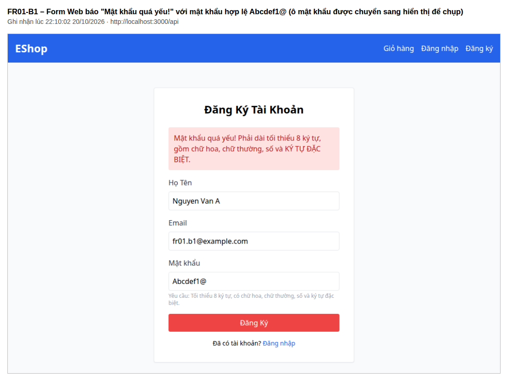
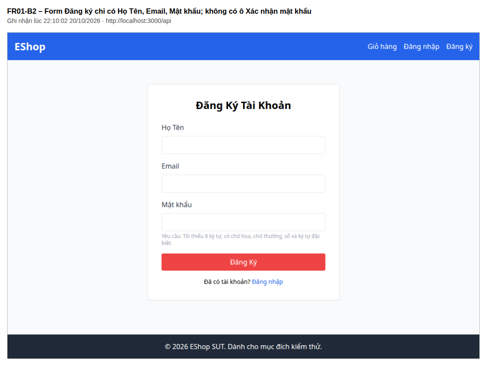
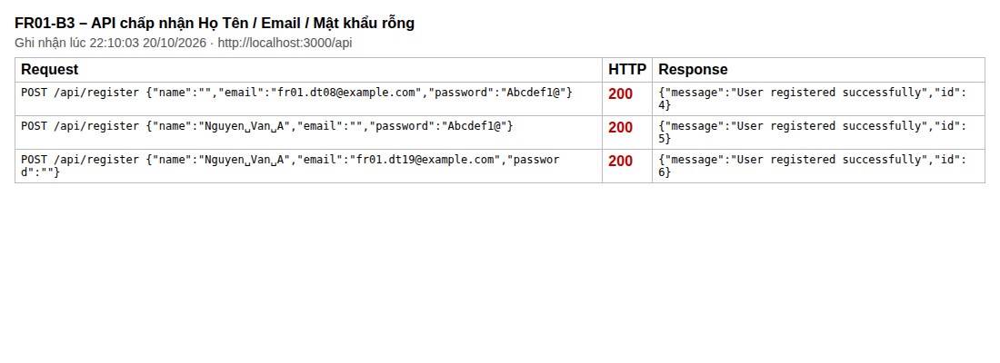
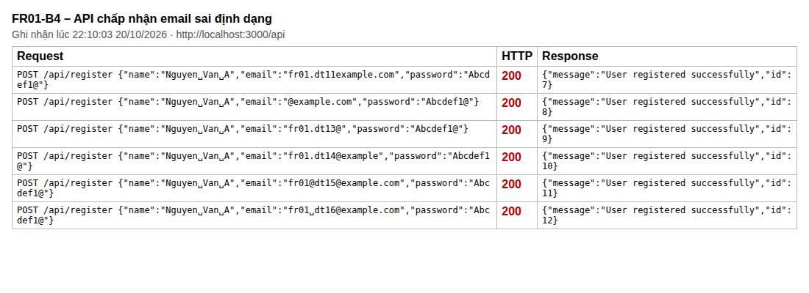
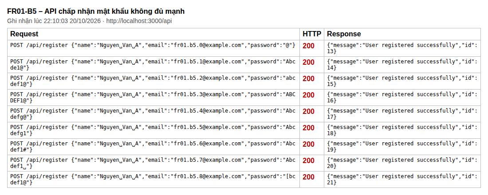
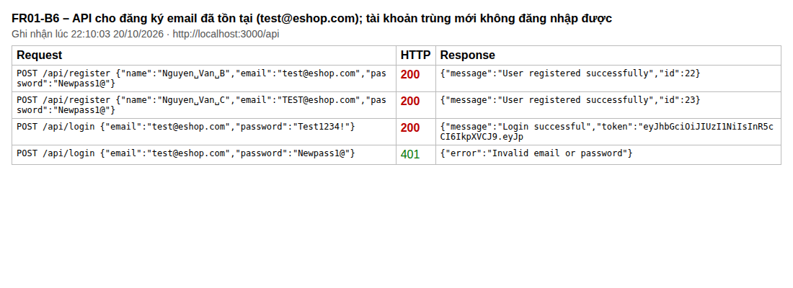
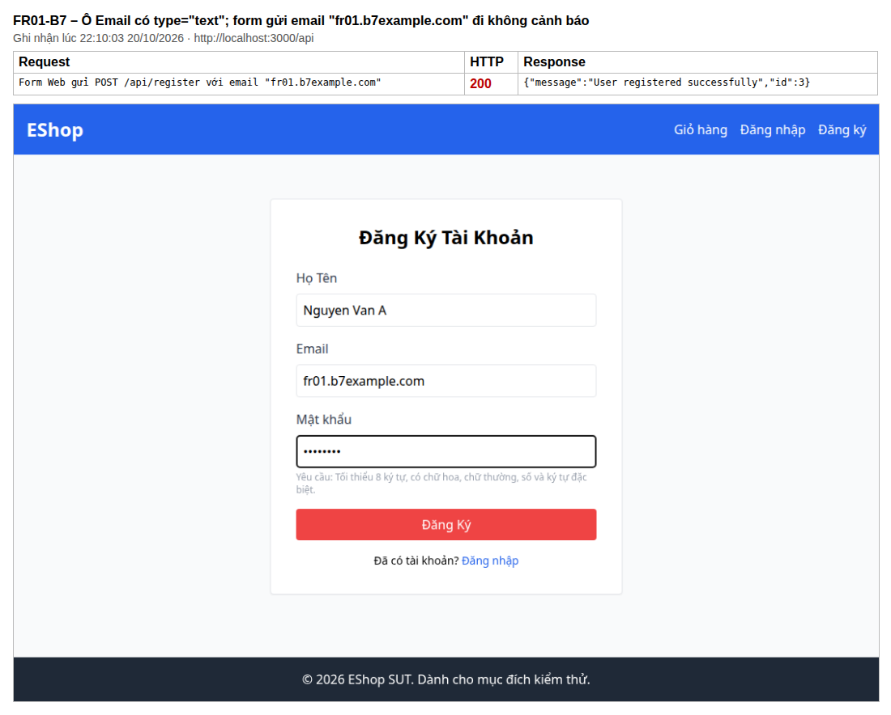
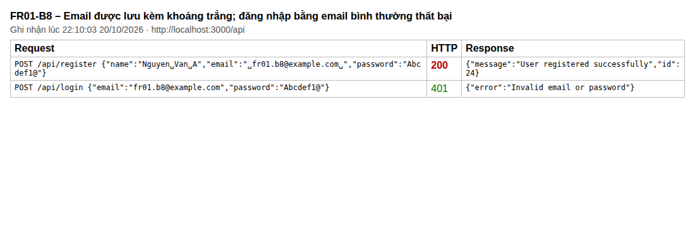
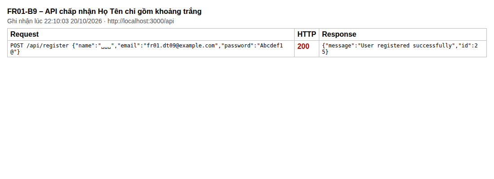

# Báo cáo bug · HW02 · 23120031

Bug được báo trên GitHub Issues của repo nhóm `d1nhnguyen/eshop-sut`, tiêu đề dạng `[BUG-NN] [FR-xx] <tóm tắt>`. Mỗi bug dưới đây có mã tạm (vd `FR01-B1`) dùng trong báo cáo feature; cột **Issue** ghi số `BUG-NN` sau khi tạo issue. Nội dung theo mẫu Problem Report [Kaner, TCS ch.5]: tái hiện được, ít bước nhất, không phán xét, nêu hậu quả nghiêm trọng nhất và các đường khác dẫn tới cùng lỗi.

**Môi trường chung:** EShop SUT (`d1nhnguyen/eshop-sut`, commit `85af3ba`), backend Node 20.19.5 khởi động lại trước khi tái hiện (dữ liệu seed), Web `http://localhost:5173`, Chrome 155, Ubuntu 24.04. Người báo: 23120031. Ngày: 2026-10-20.

**Mức độ:** Critical (chặn chức năng chính / hỏng dữ liệu) · Major (vi phạm yêu cầu, có cách khác dùng được) · Minor (ảnh hưởng nhỏ hoặc phụ thuộc giả định) · Trivial.

## Tổng hợp

| Mã | Issue | Feature | Tiêu đề issue đề xuất | Mức độ | Thành phần | TC phát hiện |
| --- | --- | --- | --- | --- | --- | --- |
| FR01-B1 | | FR-01 | Form Đăng ký trên Web báo "Mật khẩu quá yếu" với mọi mật khẩu hợp lệ có ký tự đặc biệt `@ $ ! % * ? &` | Critical | Web | FR01-DT-01…FR01-DT-07, FR01-BV-04…FR01-BV-08, FR01-DT-29, FR01-DT-32 |
| FR01-B2 | | FR-01 | Form Đăng ký thiếu ô "Xác nhận mật khẩu" | Major | Web | FR01-DT-26…FR01-DT-28, FR01-BV-20, FR01-BV-21 |
| FR01-B3 | | FR-01 | API đăng ký chấp nhận Họ Tên, Email hoặc Mật khẩu rỗng | Major | Backend | FR01-DT-08, FR01-DT-10, FR01-DT-19 |
| FR01-B4 | | FR-01 | API đăng ký chấp nhận email sai định dạng | Major | Backend | FR01-DT-11…FR01-DT-16 |
| FR01-B5 | | FR-01 | API đăng ký chấp nhận mật khẩu không đủ mạnh | Major | Backend | FR01-DT-20…FR01-DT-25, FR01-BV-01…FR01-BV-03, FR01-BV-09…FR01-BV-13, FR01-DT-29…FR01-DT-31 |
| FR01-B6 | | FR-01 | Hệ thống cho đăng ký bằng email đã tồn tại, tạo tài khoản trùng | Critical | Backend | FR01-DT-17, FR01-DT-18, FR01-BV-19 |
| FR01-B7 | | FR-01 | Ô Email ở form Đăng ký dùng `type="text"`, không kiểm tra định dạng email | Minor | Web | Quan sát B1; FR01-DT-11…FR01-DT-16 (lượt khảo sát Web) |
| FR01-B8 | | FR-01 | Email đăng ký được lưu kèm khoảng trắng đầu/cuối, không đăng nhập được bằng email bình thường | Minor | Backend | FR01-DT-02, FR01-BV-19 |
| FR01-B9 | | FR-01 | Hệ thống chấp nhận Họ Tên chỉ gồm khoảng trắng | Minor | Web, Backend | FR01-DT-09 |

## Chi tiết

### FR01-B1 – Form Đăng ký trên Web báo "Mật khẩu quá yếu" với mọi mật khẩu hợp lệ có ký tự đặc biệt `@ $ ! % * ? &`

| Trường | Nội dung |
| --- | --- |
| Feature / FR | FR-01 Đăng ký tài khoản (yêu cầu mật khẩu mạnh) |
| Thành phần | Web – trang `/register` |
| Loại | Lỗi lập trình (kiểm tra phía client sai) |
| Mức độ / Ưu tiên | Critical / Cao |
| Tái hiện được | Luôn luôn (7/7 ký tự trong tập; 13/13 test case Web có mật khẩu hợp lệ) |
| TC phát hiện | FR01-DT-01…FR01-DT-07, FR01-BV-04…FR01-BV-08, FR01-DT-29, FR01-DT-32 (kênh Web) |

**Các bước tái hiện**

1. Mở `http://localhost:5173/register`.
2. Nhập Họ Tên `Nguyen Van A`, Email `fr01.b1@example.com`, Mật khẩu `Abcdef1@`.
3. Bấm "Đăng Ký".

**Kết quả mong đợi** (FR-01): mật khẩu có 8 ký tự, có chữ hoa, chữ thường, chữ số và `@` → đăng ký thành công, chuyển tới trang Đăng nhập.

**Kết quả thực tế:** form hiện "Mật khẩu quá yếu! Phải dài tối thiểu 8 ký tự, gồm chữ hoa, chữ thường, số và KÝ TỰ ĐẶC BIỆT.", không gửi request. Kết quả giống hệt với `Mậtkhẩu1@` (có thêm chữ có dấu), `Abcdef1$`, `Abcdef1!`, `Abcdef1%`, `Abcdef1*`, `Abcdef1?`, `Abcdef1&` và 25 ký tự đặc biệt khác. Ngược lại, `Abcdef1␣` (ký tự đặc biệt duy nhất là dấu cách, không thuộc tập của đặc tả) lại được chấp nhận và đăng ký thành công.

**Phân tích:** form chỉ coi dấu cách là ký tự đặc biệt. Hậu quả: không người dùng nào đăng ký được trên Web bằng mật khẩu đúng đặc tả, đồng thời mật khẩu không có ký tự đặc biệt hợp lệ lại lọt qua. Đường khác: gọi trực tiếp `POST /api/register` vẫn đăng ký được (xem FR01-B5). Liên quan: FR01-B5.

**Bằng chứng:** `bugs/screenshots/FR01-B1.png`; `evidence/FR-01/explore_web_password.json` (43 mật khẩu khảo sát); ảnh từng test case `evidence/FR-01/web/FR01-DT-01.png`…

### FR01-B2 – Form Đăng ký thiếu ô "Xác nhận mật khẩu"

| Trường | Nội dung |
| --- | --- |
| Feature / FR | FR-01 ("Phải có trường Xác nhận mật khẩu") |
| Thành phần | Web – trang `/register` |
| Loại | Lỗi lập trình (thiếu chức năng) |
| Mức độ / Ưu tiên | Major / Cao |
| Tái hiện được | Luôn luôn |
| TC phát hiện | FR01-DT-26, FR01-DT-27, FR01-DT-28, FR01-BV-20, FR01-BV-21 |

**Các bước tái hiện**

1. Mở `http://localhost:5173/register`.

**Kết quả mong đợi** (FR-01): form có ô "Xác nhận mật khẩu"; hệ thống từ chối nếu hai ô mật khẩu không khớp.

**Kết quả thực tế:** form chỉ có Họ Tên, Email, Mật khẩu.

**Phân tích:** người dùng gõ nhầm mật khẩu (ô bị che) sẽ không được phát hiện và không đăng nhập được bằng mật khẩu mình định đặt.

**Bằng chứng:** `bugs/screenshots/FR01-B2.png`

### FR01-B3 – API đăng ký chấp nhận Họ Tên, Email hoặc Mật khẩu rỗng

| Trường | Nội dung |
| --- | --- |
| Feature / FR | FR-01 ("Người dùng phải cung cấp Họ Tên, Email, Mật khẩu") |
| Thành phần | Backend – `POST /api/register` |
| Loại | Lỗi lập trình (thiếu kiểm tra phía server) |
| Mức độ / Ưu tiên | Major / Cao |
| Tái hiện được | Luôn luôn |
| TC phát hiện | FR01-DT-08, FR01-DT-10, FR01-DT-19 (kênh API) |

**Các bước tái hiện**

1. Gửi `POST http://localhost:3000/api/register` với body `{"name": "", "email": "fr01.dt08@example.com", "password": "Abcdef1@"}`.
2. Lặp lại với `"email": ""` và với `"password": ""` (các trường còn lại hợp lệ).

**Kết quả mong đợi:** mã lỗi 4xx kèm thông báo thiếu trường; không tạo tài khoản.

**Kết quả thực tế:** cả 3 request trả `200 {"message": "User registered successfully"}`; tài khoản được tạo (trang Quản lý Người dùng của Web Admin có tài khoản ID 5 không có email).

**Phân tích:** form Web chặn ô trống bằng thuộc tính `required` của trình duyệt, nhưng mọi client gọi API trực tiếp (Postman, app mobile…) đều tạo được tài khoản thiếu thông tin. Liên quan: FR01-B4, FR01-B5, FR01-B9.

**Bằng chứng:** `bugs/screenshots/FR01-B3.png`, `bugs/screenshots/FR01-admin-users.png`

### FR01-B4 – API đăng ký chấp nhận email sai định dạng

| Trường | Nội dung |
| --- | --- |
| Feature / FR | FR-01 ("Email phải có định dạng hợp lệ `user@domain.com`") |
| Thành phần | Backend – `POST /api/register` |
| Loại | Lỗi lập trình (thiếu kiểm tra phía server) |
| Mức độ / Ưu tiên | Major / Cao |
| Tái hiện được | Luôn luôn (6/6 kiểu sai định dạng) |
| TC phát hiện | FR01-DT-11…FR01-DT-16 (kênh API) |

**Các bước tái hiện**

1. Gửi `POST /api/register` với `{"name": "Nguyen Van A", "email": "fr01.dt11example.com", "password": "Abcdef1@"}`.
2. Lặp lại với email `@example.com`, `fr01.dt13@`, `fr01.dt14@example`, `fr01@dt15@example.com`, `fr01 dt16@example.com`.

**Kết quả mong đợi:** từ chối với thông báo email sai định dạng.

**Kết quả thực tế:** cả 6 request trả 200 và tạo tài khoản với email sai định dạng (hiển thị trong Quản lý Người dùng).

**Phân tích:** form Web cũng không kiểm tra định dạng (FR01-B7), nên lỗi xảy ra cả qua giao diện. Tài khoản có email không dùng được cho chức năng Quên mật khẩu (FR-03).

**Bằng chứng:** `bugs/screenshots/FR01-B4.png`, `bugs/screenshots/FR01-admin-users.png`

### FR01-B5 – API đăng ký chấp nhận mật khẩu không đủ mạnh

| Trường | Nội dung |
| --- | --- |
| Feature / FR | FR-01 (mật khẩu ≥ 8 ký tự, có chữ hoa, chữ thường, chữ số, ký tự đặc biệt `@ $ ! % * ? &`) |
| Thành phần | Backend – `POST /api/register` |
| Loại | Lỗi lập trình (thiếu kiểm tra phía server) |
| Mức độ / Ưu tiên | Major / Cao |
| Tái hiện được | Luôn luôn |
| TC phát hiện | FR01-DT-20…FR01-DT-25, FR01-BV-01…FR01-BV-03, FR01-BV-09…FR01-BV-13, FR01-DT-29…FR01-DT-31 (kênh API) |

**Các bước tái hiện**

1. Gửi `POST /api/register` với `{"name": "Nguyen Van A", "email": "fr01.b5.0@example.com", "password": "@"}`.
2. Lặp lại với mật khẩu `Abcde1@` (7 ký tự), `abcdef1@` (không chữ hoa), `ABCDEF1@` (không chữ thường), `Abcdefg@` (không chữ số), `Abcdefg1` (không ký tự đặc biệt), `Abcdef1#`, `Abcdef1␣` (ký tự đặc biệt ngoài tập), `Đbcdef1@`, `ABCDEă1@` (chữ hoa / chữ thường duy nhất là chữ có dấu – A10).

**Kết quả mong đợi:** từ chối với thông báo mật khẩu không đủ mạnh.

**Kết quả thực tế:** mọi request trả 200 và tạo tài khoản; đăng nhập được bằng mật khẩu 1 ký tự.

**Phân tích:** chính sách mật khẩu chỉ tồn tại ở form Web (và form đó cũng sai – FR01-B1); gọi API trực tiếp bỏ qua hoàn toàn. Hậu quả bảo mật: tài khoản có mật khẩu dễ đoán.

**Bằng chứng:** `bugs/screenshots/FR01-B5.png`

### FR01-B6 – Hệ thống cho đăng ký bằng email đã tồn tại, tạo tài khoản trùng

| Trường | Nội dung |
| --- | --- |
| Feature / FR | FR-01 ("Email … là duy nhất trong hệ thống") |
| Thành phần | Backend – `POST /api/register` (xảy ra cả khi đăng ký qua Web) |
| Loại | Lỗi lập trình (thiếu kiểm tra trùng / ràng buộc duy nhất) |
| Mức độ / Ưu tiên | Critical / Cao |
| Tái hiện được | Luôn luôn |
| TC phát hiện | FR01-DT-17, FR01-DT-18, FR01-BV-19 (kênh API; lượt khảo sát Web cho kết quả giống) |

**Các bước tái hiện**

1. Gửi `POST /api/register` với `{"name": "Nguyen Van B", "email": "test@eshop.com", "password": "Newpass1@"}` (`test@eshop.com` là tài khoản có sẵn).
2. Đăng nhập `test@eshop.com / Test1234!`, rồi `test@eshop.com / Newpass1@`.

**Kết quả mong đợi:** bước 1 bị từ chối với thông báo email đã tồn tại.

**Kết quả thực tế:** bước 1 trả 200 và tạo **tài khoản thứ hai** cùng email `test@eshop.com` (Quản lý Người dùng hiện ID 2 và ID 22 cùng email). Đăng nhập bằng `Test1234!` vẫn vào tài khoản cũ, còn `Newpass1@` báo "Invalid email or password" – tài khoản mới tạo không dùng được. Email `TEST@eshop.com` và `␣test@eshop.com` cũng được chấp nhận.

**Phân tích:** vi phạm tính duy nhất của email – dữ liệu người dùng bị trùng, người đăng ký sau được báo thành công nhưng không bao giờ đăng nhập được; các chức năng tra cứu theo email (đăng nhập, quên mật khẩu) trở nên mơ hồ. Liên quan: FR01-B8.

**Bằng chứng:** `bugs/screenshots/FR01-B6.png`, `bugs/screenshots/FR01-admin-users.png`

### FR01-B7 – Ô Email ở form Đăng ký dùng `type="text"`, không kiểm tra định dạng email

| Trường | Nội dung |
| --- | --- |
| Feature / FR | FR-01 (định dạng email), FR-22 ("Trường Email phải dùng `type="email"`") |
| Thành phần | Web – trang `/register` |
| Loại | Lỗi lập trình |
| Mức độ / Ưu tiên | Minor / Trung bình |
| Tái hiện được | Luôn luôn |
| TC phát hiện | Quan sát giao diện ở bước 1; FR01-DT-11…FR01-DT-16 (lượt khảo sát Web) |

**Các bước tái hiện**

1. Mở `http://localhost:5173/register`, kiểm tra thuộc tính của ô Email (DevTools): `type="text"`.
2. Nhập Họ Tên `Nguyen Van A`, Email `fr01.b7example.com`, Mật khẩu `Abcdef1␣` (mật khẩu duy nhất form cho qua – FR01-B1), bấm "Đăng Ký".

**Kết quả mong đợi:** ô Email là `type="email"`, trình duyệt / form báo email sai định dạng và không gửi đi.

**Kết quả thực tế:** form gửi request ngay, server trả 200, chuyển tới trang Đăng nhập.

**Bằng chứng:** `bugs/screenshots/FR01-B7.png`

### FR01-B8 – Email đăng ký được lưu kèm khoảng trắng đầu/cuối

| Trường | Nội dung |
| --- | --- |
| Feature / FR | FR-01 (định dạng email); giả định A4 (bỏ khoảng trắng đầu/cuối như `type="email"` của HTML5) |
| Thành phần | Backend – `POST /api/register` |
| Loại | Lỗi lập trình |
| Mức độ / Ưu tiên | Minor / Thấp |
| Tái hiện được | Luôn luôn |
| TC phát hiện | FR01-DT-02, FR01-BV-19 (kênh API) |

**Các bước tái hiện**

1. Gửi `POST /api/register` với `{"name": "Nguyen Van A", "email": "␣fr01.b8@example.com␣", "password": "Abcdef1@"}`.
2. Đăng nhập với `fr01.b8@example.com / Abcdef1@`.

**Kết quả mong đợi:** email được lưu là `fr01.b8@example.com`; bước 2 đăng nhập thành công.

**Kết quả thực tế:** bước 1 trả 200 nhưng email được lưu nguyên kèm khoảng trắng; bước 2 báo "Invalid email or password". Với `␣test@eshop.com`, hệ thống còn không phát hiện email đã tồn tại (FR01-B6).

**Bằng chứng:** `bugs/screenshots/FR01-B8.png`

### FR01-B9 – Hệ thống chấp nhận Họ Tên chỉ gồm khoảng trắng

| Trường | Nội dung |
| --- | --- |
| Feature / FR | FR-01 ("phải cung cấp Họ Tên"); giả định A4 |
| Thành phần | Web (`required` chỉ chặn ô trống) và Backend |
| Loại | Lỗi lập trình |
| Mức độ / Ưu tiên | Minor / Thấp |
| Tái hiện được | Luôn luôn |
| TC phát hiện | FR01-DT-09 (kênh API; lượt khảo sát Web cho kết quả giống) |

**Các bước tái hiện**

1. Gửi `POST /api/register` với `{"name": "␣␣␣", "email": "fr01.dt09@example.com", "password": "Abcdef1@"}`.

**Kết quả mong đợi:** từ chối, báo thiếu Họ Tên.

**Kết quả thực tế:** 200, tạo tài khoản có tên chỉ gồm khoảng trắng. Trên Web, ô Họ Tên `␣␣␣` cũng qua được thuộc tính `required`.

**Bằng chứng:** `bugs/screenshots/FR01-B9.png`

## Ảnh trang GitHub Issues

<!-- Sau khi tạo issue: chụp trang issue, lưu bugs/screenshots/BUG-NN_issue.png và chèn vào đây. -->
